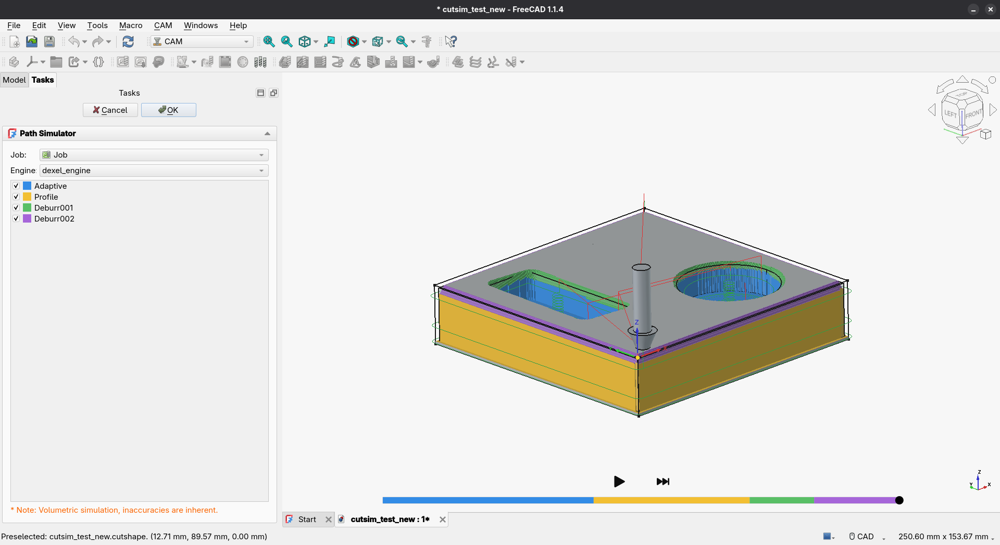
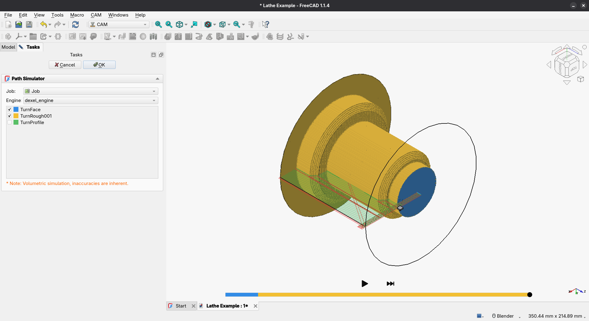

# FreeCAD Path Simulation
A FreeCAD CAM addon for previewing milling and turning tool paths, with optional
material-removal simulation.

## Screenshots



## Requirements
* FreeCAD with the CAM workbench (the legacy Path workbench is not supported)
* Python 3 and Qt 5

## Installation
Clone or extract this repository into your [FreeCAD `Mod/` directory](https://www.freecadweb.org/wiki/Installing_more_workbenches),
then restart FreeCAD.

## Usage
1. Open a CAM job and select **CAM -> CAM Addons -> Path Simulator Next**.
2. Choose the operations and engine: `dexel_engine` removes material;
   `move_only_engine` previews tool motion only.
3. Use **Play**, **Pause**, or **Jump to end**. Click or drag the timeline to seek.

Tools need valid geometry, feeds and spindle speed. Unset rapids use 1,000 mm/min.
Setup errors stop playback with a message explaining what to fix.
Turning currently supports straight G0/G1 moves only.

## Timeline seeking
Click the timeline or drag its marker to jump to a position. The marker moves
immediately while the stock is rebuilt, preserving the play/pause state.
Backward seeks may take longer. **Jump to end** shows the final simulated stock
without playing the remaining moves.

## Tests
Run without FreeCAD:
```sh
python3 -B -m unittest discover -s tests -v
```

## Feedback
Report bugs or share feedback on the [Path Forum](https://forum.freecadweb.org/viewforum.php?f=15).

## Disclaimer
This experimental tool is used at your own risk. Machine tools are dangerous;
the author is not responsible for damage or injury caused by incorrect machining
parameters.
